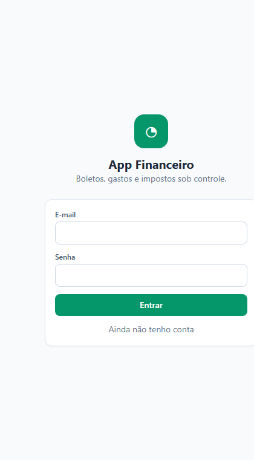
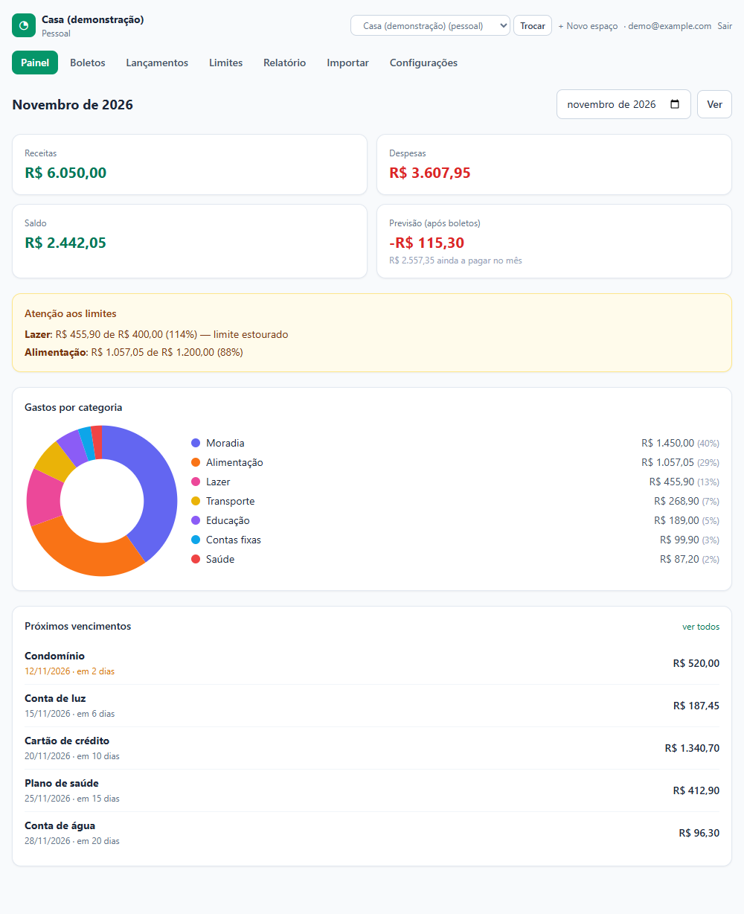
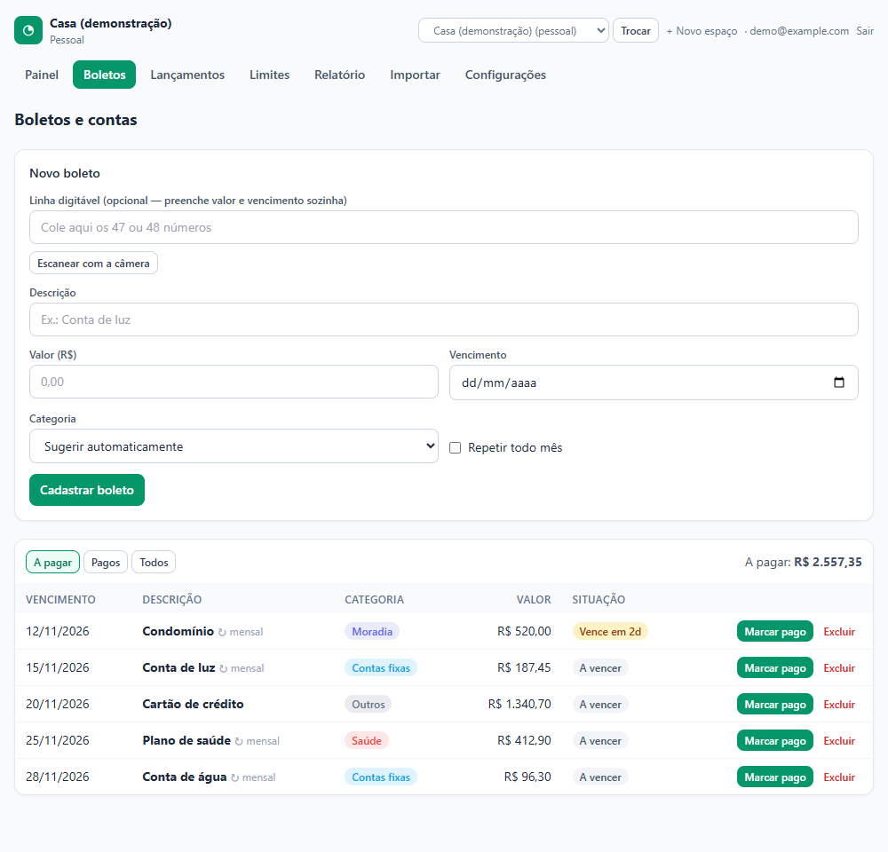
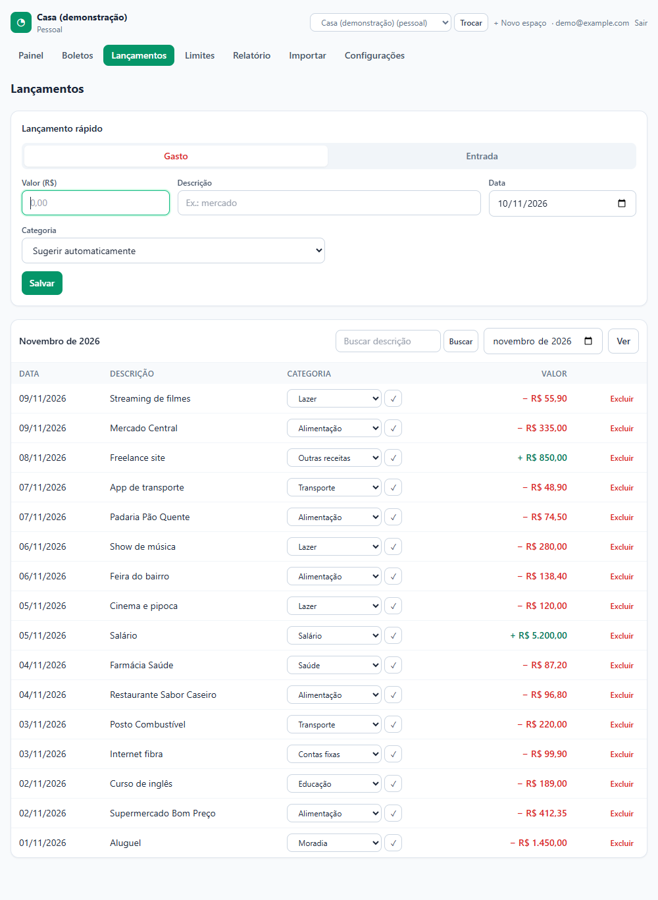
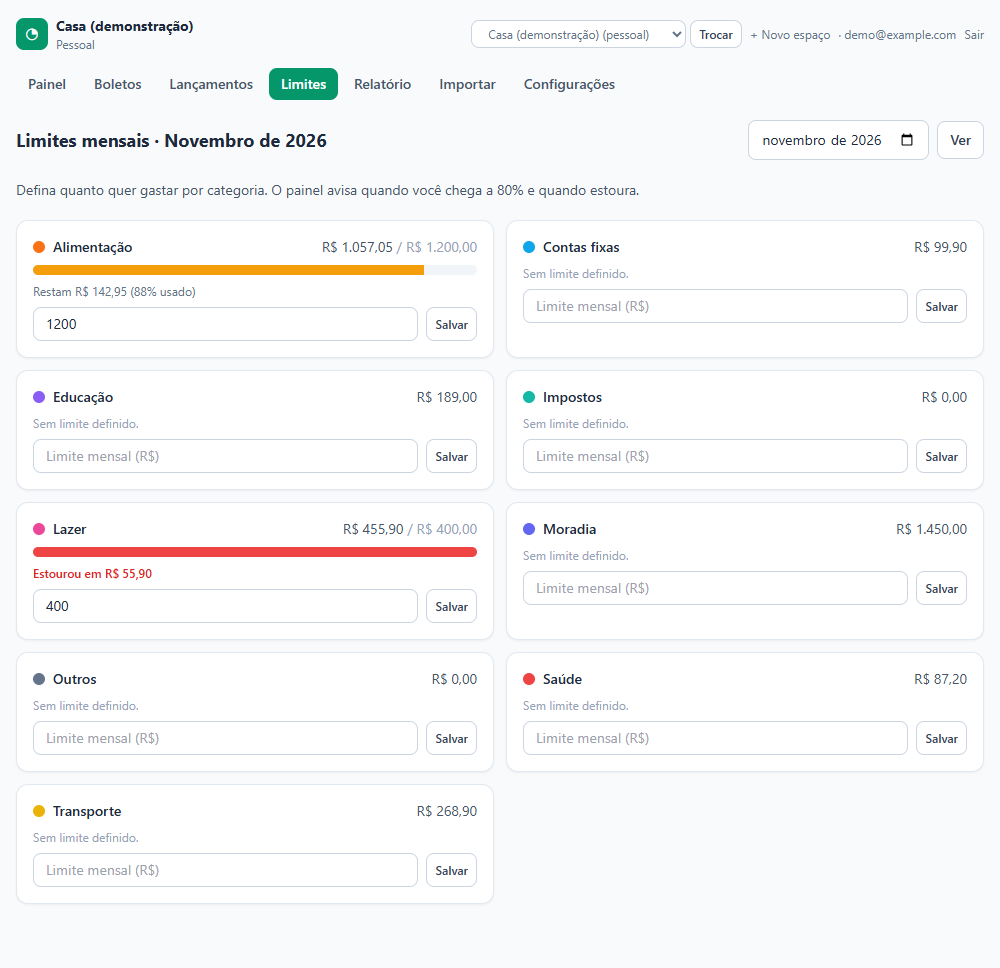
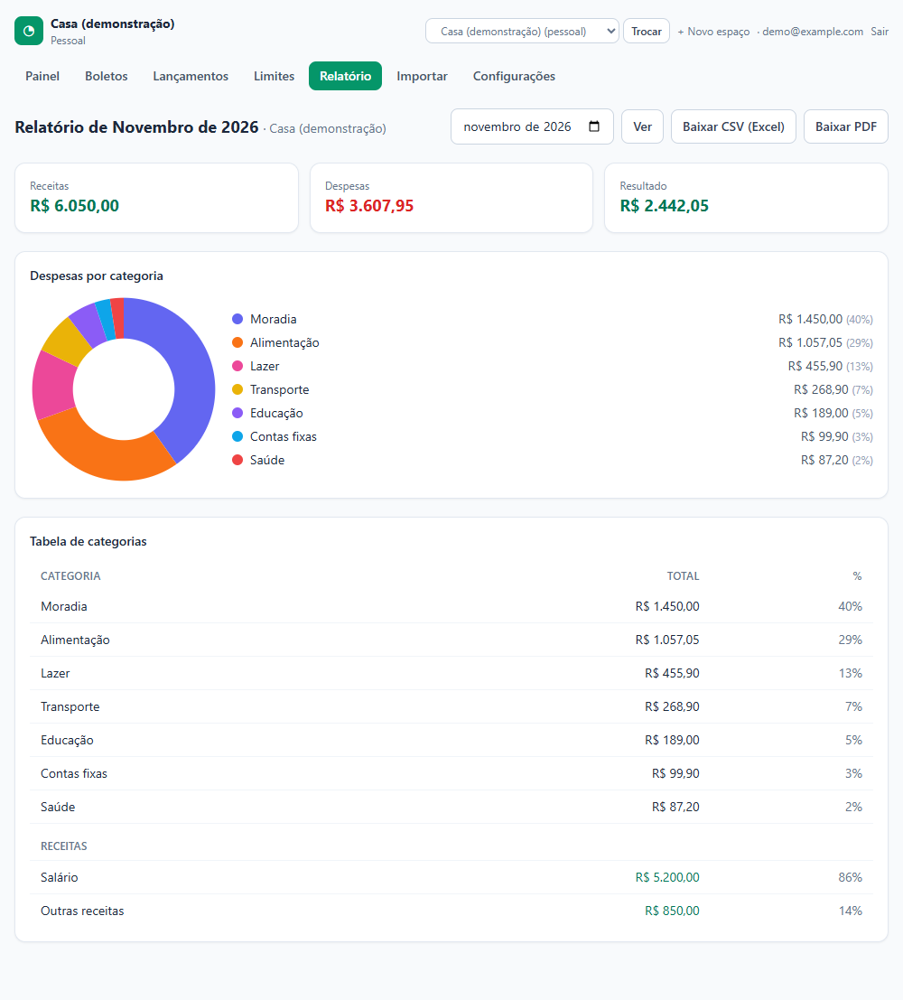
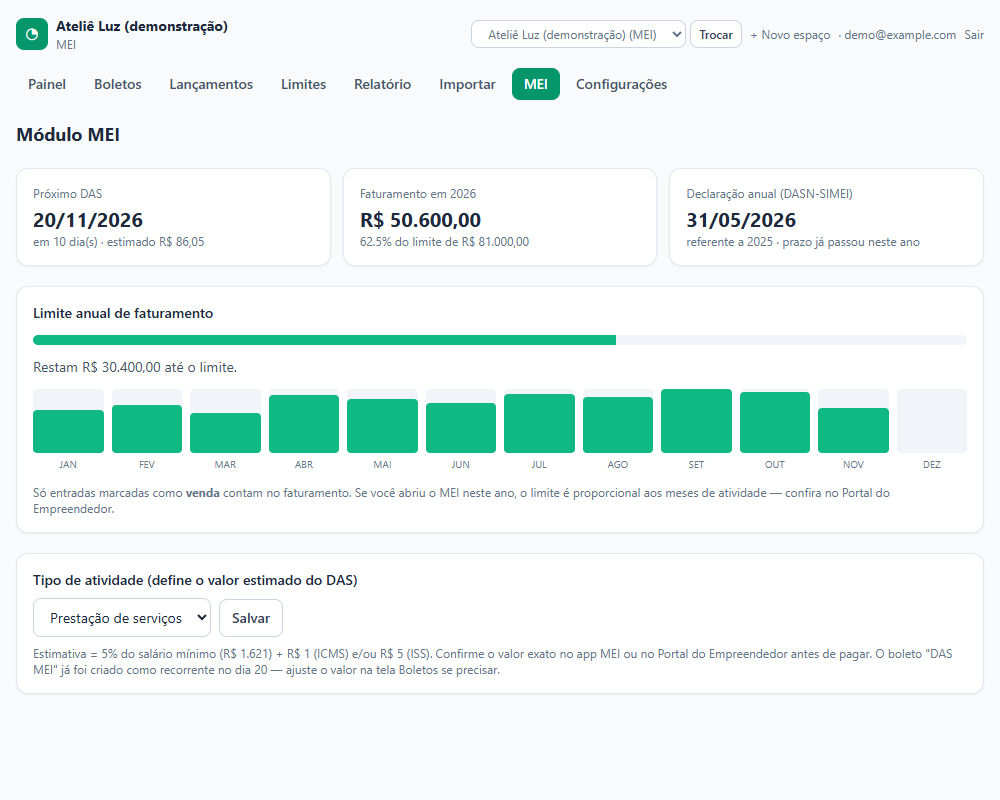

# 💰 App Financeiro

Aplicativo web, instalável no celular (PWA), para controlar **boletos, gastos, limites e impostos do MEI** em um só lugar. Feito para **pessoa física** e **MEI**, em português.

> ## 🤖 Projeto criado com IA
> Este projeto foi **idealizado por mim e desenvolvido com apoio de Inteligência Artificial** (Claude Code, da Anthropic). A IA escreveu e revisou grande parte do código, dos testes e da documentação; eu defini o escopo, os requisitos e as decisões de produto, testei no dia a dia e publiquei. Ele é um projeto pessoal de aprendizado e uso próprio, **não é um produto financeiro certificado** e não substitui um contador (veja [Avisos](#-avisos)).



## ✨ Principais funcionalidades

| | |
|---|---|
| 🧾 **Boletos** | Cadastro manual, leitura da **linha digitável** (preenche valor e vencimento), leitura do **código de barras pela câmera** e boletos recorrentes |
| 🔔 **Avisos de vencimento** | Por e-mail e notificação push no celular: 7, 3, 1 dia antes e no dia (cada pessoa escolhe) |
| ⚡ **Lançamentos rápidos** | Gastos e entradas com **categoria sugerida automaticamente**, que aprende com as suas correções |
| 📥 **Importação de extrato** | Arquivos **OFX** ou **CSV** do banco |
| 🎯 **Limites por categoria** | Barra de progresso e alerta ao chegar em 80% |
| 📊 **Painel** | Receitas, despesas, saldo, previsão do mês após os boletos, pizza por categoria e próximos vencimentos |
| 📄 **Relatório mensal** | Tabela e gráfico, exportável em **CSV** e **PDF** (gerado no próprio aparelho) |
| 🧑‍💼 **Módulo MEI** | DAS todo dia 20, faturamento contra o limite anual, relatório de receitas brutas e prazo da DASN-SIMEI |
| 👥 **Vários aparelhos e pessoas** | Dados em tempo real para quem for convidado, com papéis de administrador e colaborador |
| 🗂️ **Espaços separados** | Um mesmo login pode ter um espaço **Pessoal** e outro **MEI** |

Mais detalhes em [docs/funcionalidades.md](docs/funcionalidades.md). Quer entender o processo ou recriar o app com IA? Veja [docs/como-foi-feito.md](docs/como-foi-feito.md). Vai alterar o código (você ou uma IA)? Leia [docs/guia-para-ia.md](docs/guia-para-ia.md).

## 🖼️ Telas

| Painel | Boletos | Lançamentos |
|---|---|---|
|  |  |  |

| Limites | Relatório | MEI |
|---|---|---|
|  |  |  |

> As imagens usam **dados fictícios**.

## 🛠️ Tecnologias

- **[Next.js](https://nextjs.org)** (App Router, Server Actions) e **React 19**
- **TypeScript** e **Tailwind CSS**
- **[Supabase](https://supabase.com)**: Postgres, autenticação, Realtime e segurança por linha (RLS)
- **Vercel**: hospedagem e rotina diária (Cron)
- **web-push** (notificações), **pdf-lib** (PDF), **ZXing** (leitura de código de barras)
- **Vitest** para testes

Visão geral da arquitetura em [docs/arquitetura.md](docs/arquitetura.md).

## 🚀 Como rodar

Você precisa de **Node.js 20.9+** e uma conta gratuita no **Supabase**.

```bash
npm install
cp .env.example .env.local   # preencha com as suas chaves
npm run dev
```

Antes disso, rode `supabase/schema.sql` no SQL Editor do seu projeto Supabase. O passo a passo completo (banco, e-mail, push e publicação na Vercel) está em **[docs/instalacao.md](docs/instalacao.md)**.

```bash
npm test          # testes
npm run typecheck # checagem de tipos
```

## 📁 Estrutura

```
src/
  app/(app)/        telas: painel, boletos, lançamentos, limites, relatório, importar, MEI, configurações
  app/actions.ts    ações de gravação (servidor)
  app/api/cron/     rotina diária de avisos
  components/       componentes de interface
  lib/              leitura de boleto, categorização, DAS, importação OFX/CSV, PDF (com testes)
supabase/           schema.sql (banco, RLS e funções) e migrações
public/sw.js        service worker dos avisos push
docs/               instalação, funcionalidades, arquitetura, guia para IA, como foi feito, apresentação e prints
```

## 🔒 Segurança

- Nenhuma chave é versionada: use o `.env.local` (ignorado pelo git) a partir do `.env.example`.
- Cada tabela tem **RLS** ativado: só quem é membro do espaço acessa os dados.
- A chave `service_role` é usada apenas no servidor, na rotina de avisos, protegida por `CRON_SECRET`.
- Mantenha a confirmação de e-mail ligada em produção.

## ⚠️ Avisos

- O valor do DAS exibido é uma **estimativa**. Confira `SALARIO_MINIMO` e `LIMITE_MEI` em `src/lib/das.ts` todo início de ano.
- O vencimento do DAS considera fins de semana, **não feriados**.
- Este é um projeto de portfólio feito com IA, sem garantia. Para decisões fiscais, consulte um contador.

## 📄 Licença

[MIT](LICENSE)
